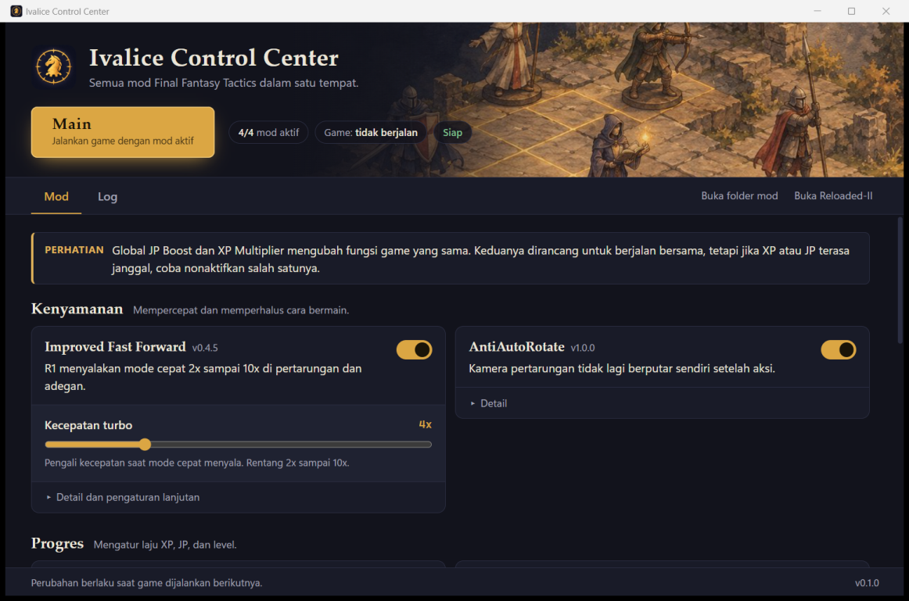

# Ivalice Master Mode

One place to install, watch and tune mods for **FINAL FANTASY TACTICS - The Ivalice Chronicles** (Steam, Enhanced version).

[Reloaded-II](https://github.com/Reloaded-Project/Reloaded-II) stays the foundation that loads mods into the game. This project adds **Ivalice Control Center**, a desktop app that sits on top of it, plus an install script that sets everything up.



## What the app does

- Lists every installed mod with a plain-language explanation of what it changes. The interface is in Indonesian.
- Turns mods on and off. Turning one on also turns on what it needs; a mod that others still need cannot be turned off.
- Edits each mod's settings with sliders and switches, checked against a safe range before saving.
- Warns about conflicts, such as two mods that hook the same game function.
- Launches the game with the enabled mods.
- Shows the latest session log and picks out the lines worth checking.
- Lists the party of the running game and reincarnates characters (see Reincarnation below).
- Edits stat growth and stat multipliers per job and per character (see Stat Tuning below).

The app changes the same files Reloaded-II reads, so Reloaded-II's own launcher keeps working alongside it. Changes to mods and settings apply the next time the game starts.

## Smart Auto Battle

This project's own mod. When a fight starts, your units act on their own using the game's built-in auto-battle, with the mode chosen by role:

- a unit with a healing skillset (White Magicks or Items by default) saves an ally who is knocked out or below the heal threshold;
- everyone else, and healers when nobody needs help, fights.

Press **F8** or click both sticks (**L3 + R3**) to switch it off and on during play; a high beep means on, a low beep means off. That is the way to take control back: while the mod is on, choosing Manual in the game's Auto-battle menu does not stick. Protect Allies and Run Like a Rabbit picked in that menu are left alone, and guests and enemies are never touched. The heal threshold and which skillsets count as healers are set in the Control Center.

With Improved Fast Forward on, units on auto-battle keep the turbo speed. Without this, the game pauses about three seconds before each of their actions, because the turbo mod holds those moments at normal speed for any unit the player owns.

**Status: tested in random battles on one save.** Units acted on their own from the first turn, a healer switched to saving a wounded ally, and F8 handed control back. Story battles with guests and special win conditions have not been tried, so save before using it there. The game still stops for its own pop-ups (for example when a unit finds an item) until you confirm them. [How it works](docs/smart-auto-battle.md) lists the evidence, the known limits and what is still unconfirmed.

## Reincarnation

This project's second mod, run from the **Reinkarnasi** tab of the Control Center while the game is open. A party member of level 10 or higher can start again at level 1 with better starting stats:

- each level given up adds 0.5% **Power** (level 10 gives +5%, level 99 gives +49.5%), and Power adds up over reincarnations to at most +100%;
- the character restarts from the average starting stats of a new recruit, raised by its Power, so every level gained afterwards builds on a higher base;
- job, JP, abilities, equipment, Brave and Faith stay as they are.

The tab lists the party with each character's stats, reincarnation count and Power, and what the next reincarnation would give. Pressing **Reinkarnasi** asks for confirmation, copies the save files to a backup folder, and sends the command to the game, which refuses it during a battle or story scene. The change becomes permanent when the game saves.

**Status: run in the game on one save.** A character was reincarnated from the Control Center on the world map; the game showed it at level 1 at once and the next autosave held the change. A battle fought by a reincarnated character has not been played through. [How it works](docs/reincarnation.md) has the evidence and the open points.

## Stat Tuning

The **Stat** tab changes how fast stats grow on a level-up (growth) and how much of a raw stat the game uses (multiplier), for HP, MP, Speed, PA and MA:

- per job, as replacement values shown next to the game's own, including the job's base Move and Jump;
- per character, as percentages on top of whatever job the character has, plus a Move and a Jump bonus;
- for your units only: enemies with the same job keep the game's values unless you switch that on.

The **Batas stat party** card can raise each party stat's ceiling independently. HP and MP can exceed 999, Speed can reach 99, and PA and MA can reach 255. The HP/MP ceiling is 9,999. The original stat format and multiplier give a maximum of 2,611 before equipment. Raising a ceiling only affects an existing calculation that reaches it. Guests and enemies keep their original limits.

The **Preset** card fills a draft for common jobs, character-specific jobs, or both. Use a quick preset or choose the stats and growth speed and multiplier percentages. Each job scales from its own defaults. **Simpan** saves the draft and **Batalkan perubahan** discards it. The **Reinkarnasi** tab includes saved tuning in its current and level-1 stats before equipment when the job row is known.

Rules saved while the game runs are picked up within a second and apply from the next battle, or the next time the Units screen opens. A multiplier shows at once; a growth only affects level-ups from then on. The game's job table is never changed, so switching the mod off undoes the multipliers; raw stats already raised by a faster growth stay in the save.

**Status: run in the game on one save.** The Units screen, two battles, level-ups under a changed growth and the enemy filter matched the arithmetic. [How it works](docs/stat-tuning.md) has the evidence and the open points.

## Mods in the catalog

| Mod | Author | What it does | Licence |
|---|---|---|---|
| [FFT Mod Loader](https://github.com/Nenkai/fftivc.utility.modloader) | Nenkai | File, table and texture mods for this game | MIT |
| Improved Fast Forward | masklovesmirror | R1 toggles 2x to 10x speed in battles and events | Not stated |
| [AntiAutoRotate](https://github.com/rexx-oss/FFT-AntiAutoRotate) | wtfjajaja | Stops the battle camera rotating on its own | Not stated |
| [Global JP Boost](https://github.com/knightsong/global-jp-boost) | knightsong | JP multiplier for every unit | GPL-3.0 |
| [XP Multiplier](https://github.com/knightsong/xp-multiplier) | knightsong | XP multiplier and level cap | GPL-3.0 |
| Smart Auto Battle | this project | Units fight on their own, healers heal | MIT |
| Reincarnation | this project | Level 10+ characters restart at level 1 with better starting stats | MIT |
| Stat Tuning | this project | Stat growth and multipliers per job and per character, for your units only | MIT |

Two Reloaded-II libraries (Signature Scanner and Shared Hooks) are installed as dependencies. Any other mod you drop into the Reloaded-II `Mods` folder also shows up in the app, with an on/off switch.

**Apart from Smart Auto Battle, Reincarnation and Stat Tuning, this repository contains none of these mods.** The install script downloads the ones with open licences from their authors' releases, builds the two GPL mods from their source with a small patch from [`patches/`](patches) (so their multipliers apply to your side only, not to enemies), and installs the two mods without a stated licence only from archives you downloaded yourself from Nexus Mods.

## Install

Requirements: Windows 11 (the script extracts `.7z` archives with the built-in `tar.exe`, which older Windows versions may not support), the Steam version of the game, `git` and `winget`. The script installs the .NET 9 SDK and the x86 .NET 9 Desktop Runtime if they are missing.

1. Download [Improved Fast Forward](https://www.nexusmods.com/finalfantasytacticstheivalicechronicles/mods/192) and [AntiAutoRotate](https://www.nexusmods.com/finalfantasytacticstheivalicechronicles/mods/173) from Nexus Mods and leave the zip files in one folder. Both are optional.
2. Run:

```powershell
git clone https://github.com/arthamegayasa/ivalice-master-mode
cd ivalice-master-mode
.\scripts\install.ps1 -ArchiveDir "$env:USERPROFILE\Downloads"
```

3. Open **Ivalice Control Center** from the desktop shortcut and press **Main**.

A prebuilt copy of the app is attached to each [release](https://github.com/arthamegayasa/ivalice-master-mode/releases) for machines that already have Reloaded-II and the mods; it needs the .NET 9 Desktop Runtime.

The script is safe to run again; it skips what is already installed. Useful parameters: `-ReloadedDir` (where Reloaded-II goes; defaults to an existing Reloaded-II, otherwise `%LOCALAPPDATA%\Programs\Reloaded-II`), `-GameDir` (if the game is not found through Steam), `-Force` (reinstall mods), `-NoShortcut`.

To remove everything, delete the Reloaded-II folder, `%APPDATA%\Reloaded-Mod-Loader-II`, `%LOCALAPPDATA%\IvaliceControlCenter` (the app's data, including save backups and the reincarnation journal), and the desktop shortcut. Nothing in the game folder is replaced; Reloaded-II adds one small file there, `steam_appid.txt`, so the game can start outside the Steam client.

See [CHANGELOG.md](CHANGELOG.md) for what has shipped.

## Adding a mod to the catalog

Edit [`catalog/mods.json`](catalog/mods.json). Each entry gives the Reloaded-II `ModId`, the text shown in the app, what the mod requires, and its settings. A setting's `key` must match the property name in the mod's own `Config.json`; `type` is `bool`, `integer` or `number`, and numeric settings take `min`, `max` and `step`.

## Development

```powershell
dotnet test tests/Ivalice.Core.Tests
dotnet test tests/Ivalice.Battle.Tests
dotnet test tests/Ivalice.Party.Tests
dotnet build src/Ivalice.ControlCenter -c Release
```

- `src/Ivalice.Core`: reads and changes a Reloaded-II profile (enabled mods, settings, diagnostics, log summary). Covered by tests.
- `src/Ivalice.Battle`: the auto-battle decision logic, as a pure function over a copy of the game's unit table. Covered by tests.
- `mods/ivalice.battle.smartautobattle`: the Reloaded-II mod that hooks the game and applies those decisions. Set `RELOADEDIIMODS` to your Reloaded-II `Mods` folder before building it.
- `src/Ivalice.Party`: the reincarnation rules, as pure functions over a copy of the game's party roster, plus the file formats the mod and the app exchange. Covered by tests.
- `mods/ivalice.party.reincarnation`: the Reloaded-II mod that finds the roster, hooks the game's per-frame routine and answers the app's commands. Its hook stub, register probe and file handling are tested in `tests/Ivalice.Party.Tests`. Build it with `RELOADEDIIMODS` set, as above; point it at a scratch folder to build without installing.
- `mods/ivalice.party.stattuning`: the Reloaded-II mod that rewrites the growth and multiplier bytes the game copies into each unit, from rules in `src/Ivalice.Party/StatTuning.cs`.
- `src/Ivalice.ControlCenter`: a WPF window hosting the HTML interface in `ui/` through WebView2, plus launching the game, backing up saves and sending reincarnation commands. Checked by hand, not by tests.
- `catalog/mods.json`: the curated mod descriptions.

## Credits and licence

The code in this repository is MIT licensed. Each mod belongs to its author and keeps its own licence. The banner and icon were generated with OpenAI's image model for this project. This is a fan project and is not affiliated with Square Enix.
